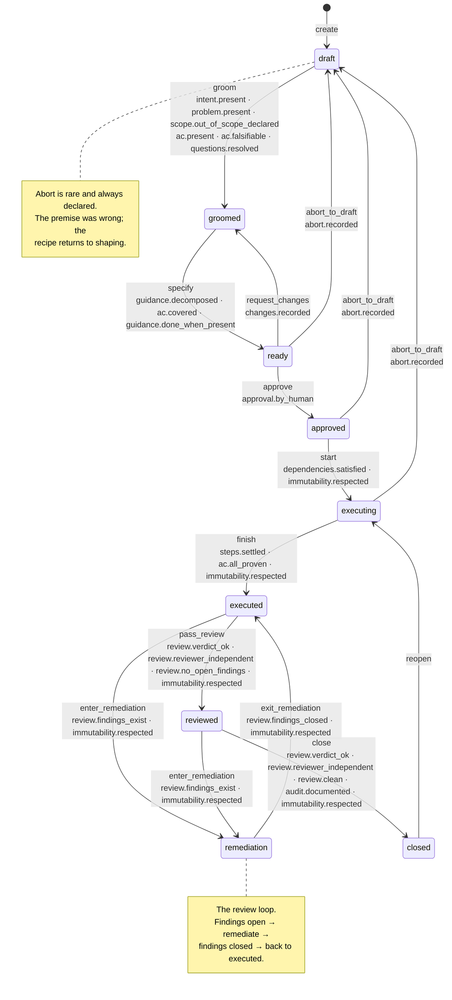

# 03 — Domain model

> 🔄 Draft. The one artifact designed explicitly up front ([ADR-0002](decisions/0002-human-interface-first.md));
> everything else is discovered by building.

## 0. Design constraints

Every rule traces to a v1 failure. This is the checklist the model must satisfy.

| # | Constraint | From |
|--:|---|---|
| C1 | **One source of truth per fact.** No stored value that can be derived. | v1 derived `lifecycle → status` in **5 places**; 4 didn't handle `executed` → a recipe escaped gates G3, G4, G7 |
| C2 | **No index file.** The directory *is* the index. | v1's `plan.json` was a 239 KB monolith whose index drifted from the recipe files (twice) |
| C3 | **Every field has a writer.** No dead flags. | v1's `needs_regrooming` had a field, an event and a TUI renderer — and no CLI path ever set it |
| C4 | **Gates and transitions are one step.** | v1's `TransitionContext::default()` was `gates_satisfied: true` → the guard was **dead code** |
| C5 | **Every state is reachable and producible.** | v1's `LIFECYCLE_STATES` had 9 strings, `RecipePhase` had 7; two were never produced |
| C6 | **One closed enum per concept, one source of truth.** | v1's step status had three answers in three places |
| C7 | **Proof, not assertion.** A proof that matched nothing is not a proof. | v1 marked an AC `passed` on a zero-match filter |
| C8 | **Evidence is append-only.** | v1's close-out ceremony overwrote per-AC evidence (3 recipes) |
| C9 | **The domain is UI-free.** | v1's `raul` shelled out to `mp` → version skew |
| C10 | **Every field is reachable from a surface.** | v1's `list recipes` omitted `priority` → the TUI's sort could not work |
| C11 | **Errors are uniform.** An unknown value is always an error. | v1 hard-errored on `--fields`, ignored `--include`, returned empty for `--type` |
| C12 | **Material edits after approval are detected.** | v1: an approved recipe could be rewritten with no signal |

---

## 1. Vocabulary — the artifact ladder

CPD's five rungs, named for a board ([ADR-0004](decisions/0004-naming.md)).

```mermaid
flowchart TB
    special["special<br/><i>rung 0</i><br/>a hunch, an observation,<br/>an agent discovery"]
    prepnote["prep note<br/><i>rung 1</i><br/>lightweight intent + scope,<br/>no acceptance criteria yet"]
    recipe["recipe<br/><i>rung 2</i><br/>full anatomy: intent, problem,<br/>scope, ACs, method, evidence"]
    course["course<br/><i>rung 3</i><br/>one intent across<br/>several recipes"]
    menu["menu<br/><i>rung 4</i><br/>coordinated recipes,<br/>ordered, cross-dependent"]

    special -->|"describes a problem worth solving"| prepnote
    prepnote -->|"success needs verifying"| recipe
    recipe -->|"a unit grows its own intent"| course
    course -->|"many, with cross-dependencies"| menu

    prepnote -.->|"demote"| special
    recipe -.->|"demote"| prepnote

    question{{"open question<br/><i>Q8 — where does a pending<br/>decision live?</i>"}}
    question -.->|"possible home"| prepnote
    question -.->|"possible home"| recipe

    classDef open fill:#2a1f33,stroke:#8a6fb0,stroke-dasharray: 4 3
    class question open
```



Promotion is **one-way and validated** — you never need to know the full scope upfront.
Demotion is allowed and unceremonious: a recipe that turns out to be a one-liner is
downgraded, not forced through the whole lifecycle.

**Rung 4 is a plan-level construct**, not a file type — the dependency graph plus an
execution order.

The dashed node is [Q8](01-vision.md#q8--does-the-ladder-need-a-decision-shaped-rung):
our ladder has no rung for *a decision we need before we can write the recipe*. Currently
that would live as prose inside a prep note. Deferred — build and observe.

### The CPD ↔ tool mapping — the single source

**[GLOSSARY.md](../GLOSSARY.md) owns it.** Every term there names its CPD
counterpart, so the two vocabularies never drift. This doc links to it rather than
repeating it.

The rule behind the split: the **artifact and the roles** get themed names; everything
an agent reasons about mechanically stays descriptive. See
[ADR-0005](decisions/0005-vocabulary.md).

| Themed | Kept plain |
|---|---|
| recipe · special · prep note · course · menu | `acceptance_criteria` · `scope` · `evidence` · `findings` · `work_packages` |
| chef · maître d' · sous chef · line cook · taster · expo | lifecycle states · gate names · `status` · `review_state` |
| `maitre-cli` · `maitre` · the skills | |

### IDs

| Entity | Form | Scope |
|---|---|---|
| recipe | `R01`, children `R01.1` | workspace |
| course | `C01` | workspace |
| prep note | `N01` | workspace |
| special | `S01` | workspace |
| acceptance criterion | `AC-01` | recipe |
| guidance step | `G1`, `G1.2` | recipe |
| work package | `WP1` | recipe |
| finding | `F-01` | recipe |
| open question | `Q-01` | recipe |

Prefixes are distinct per kind so a reference is unambiguous across directories. Allocated
from a **scan of what exists**, never from a count. (v1's `len()+1` produced
`[AC-01, AC-03, AC-03]` after a removal.)

---

## 2. The recipe anatomy

CPD's seven sections (intent, problem, scope, acceptance criteria, guidance, evidence,
audit trail) plus what the tool needs to operate on them.

```
Recipe
├── identity     id · title · slug · created · updated
├── intent       outcome · problem
├── scope        in_scope[] · out_of_scope[]
├── acceptance   [AcceptanceCriterion]
├── guidance     [WorkPackage] · [Step]
├── execution    claimed_by · claimed_at
├── evidence     completed_at
├── review       findings[] · comments[] · rounds[]
├── audit        deviations[] · decisions[]
├── approval     by · at · fingerprint
└── overlays     blocked · deferred · cancelled
```

### 2.1 Mutability

> *"Intent, problem, scope, and ACs are fixed once approved. If execution proves the
> premise wrong, that is an abort — not an edit. Guidance, evidence, and the audit trail
> are the only parts that move during execution."*

| Section | Mutability | Who writes it |
|---|---|---|
| `intent`, `problem`, `scope` | **Frozen at approval.** Change ⇒ abort to draft, or a follow-up recipe | coordinator, pre-approval |
| `acceptance` | **Frozen at approval.** A new AC ⇒ follow-up recipe | coordinator, pre-approval |
| `guidance` | Mutable, always. A deviation is recorded, not hidden | runner |
| `evidence` | Append-only | runner / verifier |
| `review` | Append-only (findings, comments) + mutable status | runner (self) / reviewer (external) / human (triage) |
| `audit` | Append-only | the domain layer |
| `approval` | Written once. `fingerprint` never changes | human |
| `overlays` | Mutable, each with a reason and a timestamp | human or agent |

**Immutability enforcement (C12).** At approval, compute a **fingerprint** over the frozen
sections (intent, problem, scope, acceptance) and store it on the approval record — a
snapshot of a past fact, not a derived value, so C1 holds. Any later mutation of those
sections is **rejected at write time**, and a hand edit to them is caught by the
`immutability.respected` gate on the recipe's next transition. This replaces v1's dead
`needs_regrooming` flag with an actual mechanism.

The fingerprint is a **pure function of the content**: the digest is taken over a
canonical form, so the same recipe hashes the same way whatever the load path and
whatever build wrote the file. A digest that depended on how the file happened to be
written would refuse every transition of a plan nobody touched. A plan approved by an
older build carries the older encoding; the tool re-stamps it canonically rather than
reading it as tampering.

### 2.2 Acceptance criterion

| Field | Notes |
|---|---|
| `id` | `AC-01` |
| `description` | What must be true |
| `verification` | A command, or `manual:` + a reproducible procedure. **Not prose.** |
| `status` | `pending` · `passed` · `failed` · `deferred` — **derived** from the proofs (C1) |
| `proofs[]` | Append-only: `{command, exit_code, output_digest, matched, at, by}` |
| `deferral` | Required when `status = deferred`: reason + follow-up reference |

`status` is **derived** — never assigned. That removes a whole class of drift.

### 2.3 Guidance

CPD principle 8: *"Prompts define intent, not implementation."* Guidance is a **proposed
path**, explicitly revisable.

| Field | Notes |
|---|---|
| `id` | `G1` |
| `work_package` | `WP1` |
| `order` | Within the work package |
| `action` | What to do |
| `files[]` | Where (hint, not a contract) |
| `depends_on[]` | Other steps |
| `covers[]` | AC ids this step advances |
| `done_when` | **Observable** — how you'll know it worked. *Not* a test command; this is not TDD |
| `status` | `pending` · `in-progress` · `done` · `skipped` · `failed` |
| `deviation` | Set when the step is done differently than described, with why |

### 2.4 Review

| Field | Notes |
|---|---|
| `findings[]` | `{id, phase: self\|external, severity: low\|medium\|high, category, description, anchor{file,line,side}, status: open\|fixed\|dismissed, created, resolved}` |
| `comments[]` | `{id, author, body, at, finding}` |
| `rounds[]` | `{n, reviewer, verdict: ok\|changes-needed, at, notes}` |

Findings live **with the recipe**, not in a plan-level `reviews.json` (v1 had both,
duplicating state).

**A note's outcome is written once.** A note is `open`, and the first writer closes it:
the fixer says *fixed* and what they fixed, or the chef says *dismissed* and why. A
second writer is refused — otherwise the chef's dismissal erases the fixer's record of
what was done, and the artifact says the note was dismissed when it was fixed. The
refusal is the plan's answer, so it is journalled.

| Move | From | To | Who | What it carries |
|---|---|---|---|---|
| `resolve` | `open` | `fixed` | the fixer — the agent that did the work | what it fixed |
| `dismiss` | `open` | `dismissed` | the chef | why it is not worth fixing |
| `reopen` | `fixed`, `dismissed` | `open` | the reviewer | the objection, **and the outcome it erased** |

The reviewer's move clears the outcome — the note is open again, so it has none — but
the record of what was done goes into the thread, which is append-only. A reopen that
dropped it would erase the fixer's record by the back door.

---

## 3. The lifecycle

### 3.1 States — nine, all reachable, all producible (C5)

```
  draft ──▶ groomed ──▶ ready ──▶ approved ──▶ executing ──▶ executed ──▶ reviewed ──▶ closed
    ▲                       │           │            │             │  ▲           │
    │                       │           │            ▼             │  │           │
    └───────────────────────┴───────────┘        remediation ─────┘  │           │
         abort to draft (premise wrong)                                  └───────────┘
                                                                              ▲
                                                                        reviewed (clean)
```

| State | CPD stage | Meaning |
|---|---|---|
| `draft` | 0–1 | Being written. Intent may be incomplete |
| `groomed` | 2 | Stress-tested. Scope bounded, ACs falsifiable, questions resolved |
| `ready` | 3 | **Locked.** Guidance decomposed; every AC covered and verifiable |
| `approved` | 4 | **A human said go.** Recorded with an approver identity |
| `executing` | 5–6 | Claimed and being implemented. Guidance may be revised |
| `executed` | 7–8 | Implementation done, ACs passed with proof, awaiting round-2 review |
| `remediation` | 9 | External findings open; being fixed |
| `reviewed` | 10 | Round-2 review clean |
| `closed` | 12 | Handed off. **Terminal** |

Stage 8 (external review) is an *activity* over an `executed` recipe, not a separate
state — matching v1's instinct, with the state now reachable and producible.

### 3.2 Transitions — one table, guards inseparable (C4)



Each edge is labelled with the event and the gates that guard it. The gates themselves are
defined once, in [§ 4](#4-gates).

**Overlays** ride alongside the lifecycle and are not edges on this graph: `block`,
`unblock`, `defer`, `resume` and `cancel` apply to any non-terminal state. `cancel` is
not a transition, so its reason is not a gate: it is checked where the overlay is
written.

**Two invariants that fix v1's worst bugs:**

1. **Decomposition precedes approval.** `specify` is a *precondition* of `approve`. In v1,
   `approve` was an alias for `set-spec-status ready`, so a bare draft with zero steps
   went `draft → approved` in one call — while decomposition was *blocked* behind
   approval. That deadlock is gone: the gates run in the natural order.
2. **Approval requires a human.** `approval.by_human` refuses an approval whose actor is
   one of the agent roles. The chef is the human; the sous chef, the line cook, the
   taster and the expo are agents, and so is the CLI's default actor `agent`. The list
   is a **deny**-list, so a human may approve under any name they like. It matches the
   actor's **name**, so an agent that calls itself `chef` passes it: the deny-list is a
   speed bump against the accident, not a boundary against the lie. CPD principle 7
   (*"Would I trust a capable agent with this prompt as it stands?"*) turned into a
   machine check instead of a prose reminder (P2).

### 3.3 Overlays

| Overlay | Fields | Notes |
|---|---|---|
| `blocked` | `reason`, `by`, `at` | A recipe can be blocked *and partly executed* — v1's G8 made that inexpressible, so fragment state carried the truth while recipe state lied |
| `deferred` | `reason`, `at` | Parked. Re-openable |
| `cancelled` | `reason`, `at` | Terminal by overlay. v1 had a `cancel_reason` field with **no writer** |

---

## 4. Gates

One table, one place, one definition each (C1, C4). v1 scattered them across five files
and had two that didn't exist (`B2`, `B3` documented but never implemented).

| Gate | Checks | Applies to |
|---|---|---|
| `intent.present` | `intent.outcome` non-empty | `groom` |
| `problem.present` | `intent.problem` non-empty | `groom` |
| `scope.out_of_scope_declared` | ≥2 out-of-scope items | `groom` |
| `ac.present` | ≥1 acceptance criterion | `groom` |
| `ac.falsifiable` | every `verification` is a command the tool can count matches from — a `go test` command, or a `manual:` procedure — **not prose, not a placeholder** | `groom` |
| `questions.resolved` | no unresolved open questions | `groom` |
| `guidance.decomposed` | ≥1 work package, ≥1 step | `specify` |
| `ac.covered` | every AC has ≥1 covering step | `specify` |
| `guidance.done_when_present` | every step has an observable `done_when` | `specify` |
| `approval.by_human` | the actor signing off is not one of the agent roles — only the chef approves | `approve` |
| `changes.recorded` | a reason is recorded for the change | `request_changes` |
| `dependencies.satisfied` | every `depends_on` recipe is `closed` | `start` |
| `steps.settled` | every step is `done` or `skipped` | `finish` |
| `ac.all_proven` | every AC is `passed` — a proof that matched something **or a human sign-off** — or **deferred** (re-filed as a follow-up) | `finish` |
| `review.findings_exist` | ≥1 open external finding | `enter_remediation` |
| `review.findings_closed` | no open external finding | `exit_remediation` |
| `review.verdict_ok` | the last review round says `ok` | `pass_review`, `close` |
| `review.reviewer_independent` | the reviewer is not the agent that did the work | `pass_review`, `close` |
| `review.no_open_findings` | no open finding of any phase | `pass_review` |
| `review.clean` | no open finding of any phase | `close` |
| `audit.documented` | the audit trail has been written up | `close` |
| `abort.recorded` | an abort reason exists | `abort_to_draft` |
| `immutability.respected` | the approval fingerprint still matches the frozen sections | `start`, `finish`, `enter_remediation`, `exit_remediation`, `pass_review`, `close` |

The table is the code's: `maitre-cli gates` prints it, and `TestTheDocListsTheGatesTheCodeHas`
compares the two, so the doc cannot drift from the gate table again.

The cancel reason is not a gate: `cancel` is an overlay, not a transition, and its reason
is checked where the overlay is written.

### 4.1 `ac.falsifiable` — the gate that leaked

The most important one. A verification is **resolvable** when the tool can determine,
without running it:

1. **It is a command the tool can count matches from** — a `go test` command, or a
   `manual:` procedure that carries a reproducible procedure. **Not prose, not a
   placeholder.** A command the tool cannot count from would produce an *unproven*
   proof, and an unproven proof never satisfies a gate — so the criterion could never
   be finished. The gate refuses it at grooming time, where the chef reads it.
2. **It runs.** The proof records the exit code, so a command that cannot run fails
   loudly instead of passing quietly.
3. **Its filter matches at least one thing.** The count comes from the output the tool
   captured: *"a gate that manufactures confidence."*

`ac.all_proven` then enforces the third at completion: every attached proof must report
**a non-zero match count**. A proof that ran and matched nothing is rejected.

**The one exception is a human sign-off.** A criterion the tool cannot check may be
signed off by the chef — the same deny-list the approval takes, because a sign-off is a
human act too. The sign-off is its own state — `signed-off`, claimed by no match. It
satisfies `ac.all_proven` explicitly, and it is the only thing that does.

---

## 5. Proofs and evidence

The rules that make CPD principle 9 (*"Verification is auditable, not aspirational"*)
actually hold.

| Rule | Detail |
|---|---|
| **A proof is machine-attached** | `{command, exit_code, output_digest, matched, at, by}` — never prose |
| **Append-only** (C8) | Re-running appends. It never overwrites. `status` derives from the latest proof |
| **Zero-match is not a proof** | `matched == 0` ⇒ rejected, recorded as a failure |
| **A sign-off is not a proof** | it is its own state (`signed-off`) — **the chef** vouching for a procedure the tool could not check. It claims no match, and it is the one exception to the zero-match rule |
| **Exit code is the truth** | `exit 0` is a pass; anything else is a fail |
| **Bypass is debt** | A forced transition is stamped `[forced]` and shows in the UI as debt, never as success (CPD principle 9) |
| **Timeouts are distinguishable** | v1's timeout message (*"verification command did not run"*) was indistinguishable from a real failure. A timeout is its own outcome, and the default deadline must fit a realistic full-suite run |

### 5.1 The L5 session boundary

Every event records `actor`, `session` and `role`, so the boundary is **checkable**:

> The session that produces code is never the session that fixes findings. The session that
> plans is never the session that reviews.

CPD's own caveat applies and must be surfaced, not hidden: the session id is a string an
agent can type. **This is an audit trail, not enforcement** — unless we find a way to make
it otherwise.

---

## 6. Plan format

```
kitchen/
  project.json                 project meta · charter · settings — NO index
  recipes/R01-<slug>.json      self-contained: spec + guidance + evidence + review + audit
  courses/C01-<slug>.json
  prep-notes/N01-<slug>.json
  specials/S01-<slug>.json
  activity.json                append-only event journal, sequence-numbered
  decisions.json               project-level decisions (ADRs)
```

One root, subdirectories per kind. The "stock vs. the line" distinction — specials and
prep notes are stock, recipes and courses are the line — is a **view in the UI**, not a
directory boundary. Two roots would cost a workspace spanning both and buy nothing, since
per-type subdirectories already allow selective commits (`git add kitchen/recipes`).

**The name follows the title, and a rename does not leave a second file.** The file is
`<id>-<slug>.json`, so a new title is a new name — and the write removes the copy the
old name left behind. One file per artifact is a rule the *writer* keeps, not a
convention the reader has to cope with: a reader that picked between two copies would
be reading a plan nobody wrote.

The reader still knows how to pick, as a safety net for the plans the old build wrote:
if a directory holds two files for one id, the reader takes the copy the artifact
itself says is newest — its own `updated` stamp, and the file's own time when the
stamps tie — and the listing counts the artifact once. That is a net under a broken
plan, not the way plans are read.

| Rule | Rationale |
|---|---|
| **One file per artifact.** Always. | Uniform, diff-friendly, git-friendly, concurrent-safe, **no index to drift** (C2) |
| **The directory is the index.** | `ListRecipes` reads the directory |
| **Recipes are self-contained.** | Review records live with the recipe, not in a plan-level file that duplicates them |
| **`activity.json` is append-only and sequence-numbered** | The basis for the audit trail, the human UI's live view, and the L5 check |
| **JSON, one object per file** | The format is already JSON in v1; the *shape* is what's changing. Validation is a runtime check, not a compile-time type |
| **No stored derived values.** | `status`, `review_state`, `lane`, `readiness`, `coverage` are computed at read time |

### 6.1 The event journal

```jsonc
{
  "schema": 1,
  "seq": 412,
  "events": [
    { "seq": 412, at: "2026-10-25T12:00:00Z", kind: "lifecycle",
      recipe: "R07", actor: "human", session: "s-3", role: "coordinator",
      data: { from: "ready", to: "approved" } }
  ]
}
```

`kind` is a **closed enum**: `created` · `lifecycle` · `evidence` · `finding` · `comment` ·
`deviation` · `decision` · `promotion` · `overlay` · `control` · `criterion` · `step` ·
`refusal`.
Unknown kinds are an error (C11), never silently ignored. The CLI prints the list the
code holds.

A `refusal` records an attempt the plan turned away: the event that was refused, the
gates that refused it, and why. The plan does not change — a refusal writes no artifact
— but the attempt is real, and the journal is the only event log.

Every entry also records the **version of the domain's rules** it was written under
(`domain_version`). The journal is written on every mutation, so the newest entry is
the plan's stamp: a tool whose rules are older than the plan's refuses to write, and a
newer tool stamps its own version on the next write. Reading is always allowed. See
`core.DomainVersion`.

**What the stamp covers is exactly what the fingerprint hashes**: the gates, the
transitions, the lifecycles, the events, the chef's moves and the rules on a tasting
note's outcome. A rule outside that list is a rule the stamp cannot see — so a rule
that changes has to be added to the list, or the plan cannot say which rules it was
written under. It is the *shape* of the rules, not their behaviour: what a gate
computes is not in the fingerprint either.

**The stamp protects the future, not the corpus.** The guard refuses only when the
plan is newer than the tool, so a plan stamped 1 stays open to a version-1 tool until
a newer build writes it and re-stamps it.

---

## 7. The operation set

**Domain operations — not CLI commands.** Both surfaces call these. See
[ADR-0003](decisions/0003-surface-split.md) for the split.

### Reading
| Operation | Purpose |
|---|---|
| `ListRecipes(filter)` | The board |
| `GetRecipe(id)` | Full artifact |
| `ListIdeas / ListBriefs / ListEpics` | The backlog |
| `GetProject()` | Charter and settings |
| `Search(query, scope)` | Find anything |
| `ComputeLane(id)` / `ComputePath(lane)` | Where it sits; what's next |
| `ComputeTree()` | The plan as a dependency tree — the trunk, and what forks at each recipe |
| `ComputeGaps(id)` | Uncovered ACs, missing guidance, unresolved questions |
| `ComputeReviewQueue()` | What needs a human decision |
| `GetActivity(since)` | The journal |
| `Validate()` | Whole-workspace integrity |

### Writing — the artifact (agent)
| Operation | Purpose |
|---|---|
| `CreateRecipe(spec)` | |
| `UpdateRecipe(id, fragment)` | **Fragment-first**: one section at a time. Never a whole-document replace |
| `TransitionRecipe(id, event)` | **The only** state mutator. Runs the gates internally (C4) |
| `RecordProof(id, acID, proof)` | Append-only |
| `RecordFinding(id, finding)` / `ResolveFinding(id, findingID, resolution)` | |
| `RecordDeviation(id, stepID, note)` | Guidance changed — say so |
| `SetStepStatus(id, stepID, status)` | |
| `ClaimRecipe(id, agent)` / `ReleaseRecipe(id)` | |

### Writing — decisions (human)
| Operation | Purpose |
|---|---|
| `ApproveRecipe(id, by)` / `RequestChanges(id, by, notes)` | |
| `TriageFinding(id, findingID, action)` | Fix, dismiss, or defer |
| `CreateIdea / UpdateIdea / PromoteIdea / DismissIdea` | |
| `CreateBrief / UpdateBrief / PromoteBrief` | |
| `CreateEpic / AddRecipeToEpic` | |
| `BlockRecipe / UnblockRecipe / DeferRecipe / ResumeRecipe / CancelRecipe` | |
| `RecordDecision(summary, context)` | Project-level ADR |

### Control
| Operation | Purpose |
|---|---|
| `SetExecutionStrategy` / `SetFocus` | |
| `GetProofSummary(id)` | Proofs attached, zero-match proofs, forced bypasses |

**Bloat guard (P11).** Every operation must be justified by a real workflow — human or
agent — and be reachable from the domain. v1's 47 commands were mostly *syntax*
variations of a handful of these. **One operation, one name.**

---

## 8. Derived views — computed, never stored (C1)

| View | Computed by | Definition |
|---|---|---|
| `status` | `Criterion.Status` | AC status derived from its latest proof |
| `review_state` | `ReviewStateOf` | `pending-review` · `open-findings` · `remediated` · `self-reviewed` · `reviewed-clean` |
| `lane` | `LaneOf` | `grooming` · `approval` · `execution` · `review` · `blocked` · `done` — the UI's primary axis |
| `readiness` | `ReadinessOf` | Can it be claimed? Why not, if not |
| `coverage` | planned | **Planned.** The AC ↔ step matrix |
| `proof_summary` | `ProofSummaryOf` | Proofs attached, zero-match proofs, forced bypasses |
| `staleness` | planned | **Planned.** Age since last activity; age since last human decision |
| `chef_move` | `ChefMoveOf` | The move the chef can make now: `sign off` · `review` · `serve` · `triage` · `none` |
| `self_reviewed` | `SelfReviewed` | The latest review round cannot count as an independent tasting: the agent that did the work signed it, or nobody signed for the work at all |
| `path` | `Path` | The execution order: what can go now, and what waits |
| `triage` | `TriageOf` | `Needs you` · `On the line` · `Being shaped` · `On hold` · `Served` — the board's other axis: what the chef should do next |
| `tree` | `TreeOf` | The plan as a dependency tree |

Two of these are **planned**: the domain does not compute them yet, and the table says
so. A view the domain does not compute is not a view — it is a promise, and a promise
that reads like a fact is how this table drifted in the first place.

The **Computed by** column is the code's own answer: every name in it is a function the
domain has, and the wire checks the table against that list in both directions.

`lane` is the UI's primary organizing axis and it is *derived* — the board can be
reorganized without a data migration. **The human's view of the plan is not part of the
plan.**

### 8.1 One fact, one answer

`self_reviewed` is read by two rules that must never disagree: the gate
`review.reviewer_independent`, which refuses the transition, and the triage, which
tells the chef the recipe needs them. A second implementation of either would be the
v1 lesson — five implementations of one projection, four of them wrong — so both read
the same function.

A work with no claimant counts as self-reviewed: nobody signed for the work, so there
is no executor to be separate from, and an anonymous claim cannot buy independence.
A claim needs an agent — `ClaimRecipe` refuses an empty one — so the state cannot be
reached by leaving out a flag.

The console had exactly that drift: the gate refused to close a self-reviewed recipe
while the console filed it under *On the line* and counted *0 need you*. The chef was
never told what was waiting.

### 8.2 The invariant that catches the class

> A recipe is filed under **Needs you** if and only if the console has a chef move for
> it.

Written down, it catches every instance of the drift rather than one at a time. It
found four more:

| Instance | What the console did |
|---|---|
| A recipe on hold | Offered *sign off* or *serve* — the console would act on something the chef had put aside |
| Approved and idle | Filed under *Needs you* with nothing to press |
| An open tasting note | Filed under *Needs you* with nothing to press |
| A blocked recipe | Offered a move it could not perform |

`TestNeedsYouMeansThereIsAMoveForYou` carries the invariant, and it carries no
exception. The open tasting note was the last one: the console can triage a note now,
so a recipe with one has a move — the triage.

---

## 9. Open questions

1. **Should `ready` and `approved` both exist?** CPD separates Specify (3) from Approve
   (4). v1 conflated them and it was a bug. Is the extra state worth it, or is one
   "committed" state enough with the human decision recorded as an event?
2. **Does `epic` need its own file type, or is it a tag on a recipe plus a dependency
   graph?** v1 had work packages (within a recipe) and never had this rung. **Proposed:**
   [06-proposals.md § 1, Courses](06-proposals.md#1-courses).
3. **Does `program` (rung 4) need an identity, or is it the dependency graph plus the
   execution order?**
4. **Can the L5 session boundary be *enforced* rather than audited?** Options: harness-side
   session tokens; a permission deny list on the CLI (the runner physically cannot call
   `reviews pass`); OS-level isolation. The deny list is the cheapest real enforcement.
5. **Is the guidance `done_when` field worth its cost?** A light answer to v1's `tests`
   field without the TDD flavor. Does it survive contact with real use?
6. **What is the workspace directory called?** (`master-plan/`? `.mp/`? something new?)
   Affects every path in every doc.
7. **How much of the charter (goals / non-goals / principles) belongs in `project.json`
   versus a human-editable document?** CPD principle 2 says living context documents carry
   what no single artifact can hold — `AGENTS.md` and friends. There may be a third
   place: the human interface's own settings. **Proposed:**
   [06-proposals.md § 2, `design_decisions`](06-proposals.md#2-design_decisions).
8. **Should the plan have questions at all?** The `questions.resolved` gate exists and
   can never fire: nothing writes a question, so the gate is satisfied by their
   absence. Is a question a thing the plan holds — and if so, who writes one, when
   does it stop being a question, and does a recipe wait for it?
