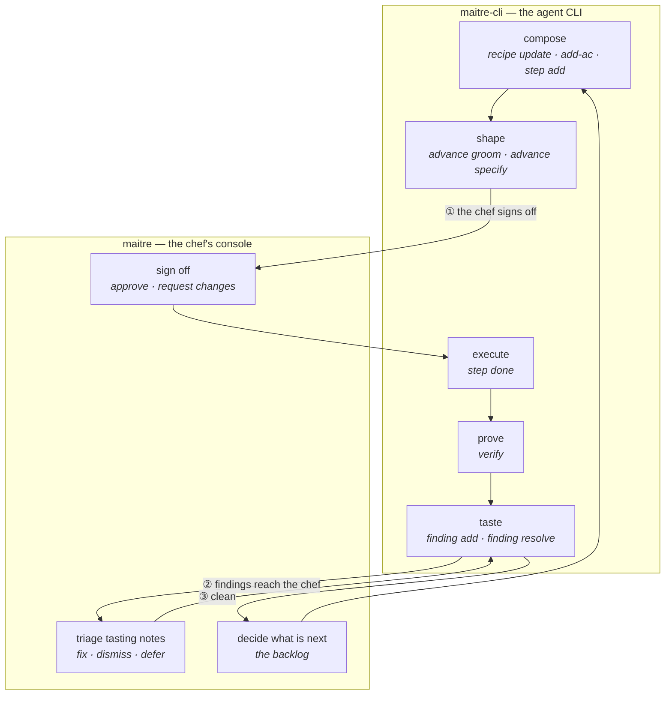
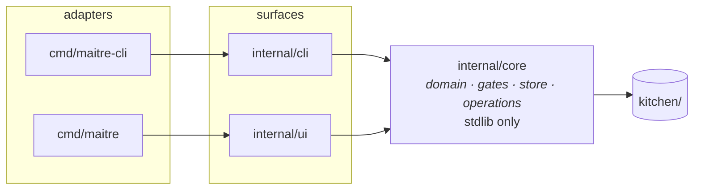

# 04 — The operation set

> 🔄 Draft. The domain layer's public surface: what the tool can do, and who does it.
> Built alongside the code, not before it ([ADR-0002](decisions/0002-human-interface-first.md)).

## The rule

**One domain, two clients.** Every operation either surface performs goes through the
domain layer, so every rule, gate and invariant applies identically to both.

**Every operation is justified by a real workflow — a human one or an agent one — and
neither surface may invent an operation the domain does not support.**

That is the guard against v1's 47 top-level commands, which were mostly *syntax*
variations of a handful of real operations: an alias, a bulk variant, a `--json` path.

## The two loops



The numbered edges are CPD's hand-off points. Each one is a **session boundary**: the
session that composes is never the session that signs off, and the session that executes
is never the session that tastes.

## The operations

✅ implemented in `internal/core/operations.go` · ⏳ not yet built

### Reading

| Operation | Reads | Workflow |
|---|---|---|
| ✅ `GetRecipe(id)` | one recipe | both |
| ✅ `ListRecipes()` | the board | both |
| ✅ `ListBacklogItems()` | the backlog | human |
| ⏳ `ListCourses()` | the backlog | human |
| ✅ `GetProject()` | charter, settings | both |
| ⏳ `Search(query, scope)` | anything | both |
| ✅ `GetJournal()` | the journal | both |
| ⏳ `Validate()` | whole-workspace integrity | both |

### Writing — the artifact (agent)

| Operation | Writes | Workflow |
|---|---|---|
| ✅ `CreateRecipe(spec)` | a new recipe | agent composes |
| ✅ `UpdateRecipe(id, fragment)` | one section at a time | agent refines |
| ✅ `AddCriterion(id, description, verification)` | an AC | agent decomposes |
| ✅ `AddWorkPackage(id, name)` | a work package | agent decomposes |
| ✅ `AddStep(id, step)` | a method step | agent decomposes |
| ✅ `SetStepStatus(id, stepID, status)` | progress | agent executes |
| ✅ `DeferCriterion(id, acID, reason, followUp)` | a criterion re-filed | agent executes |
| ✅ `VerifyCriterion(id, acID)` | an **evidence** | agent verifies |
| ✅ `RecordDeviation(id, stepID, note)` | how it differed | agent executes |
| ✅ `AddFinding(id, finding)` | a tasting note | agent tastes |
| ✅ `RecordReviewRound(id, reviewer, verdict, notes)` | a review round | agent tastes |
| ✅ `ResolveFinding(id, findingID, resolution)` | a closed finding | agent remediates |
| ✅ `ReopenFinding(id, findingID, reason)` | a finding back in the queue | agent remediates |
| ✅ `Advance(id, event)` | the lifecycle | both |

### Writing — decisions (human)

| Operation | Writes | Workflow |
|---|---|---|
| ✅ `ApproveRecipe(id, by)` | the sign-off | the chef signs off |
| ✅ `RequestChanges(id, by, notes)` | a refusal | the chef signs off |
| ✅ `DismissFinding(id, findingID, reason)` | a dismissed tasting note | the chef triages |
| ⏳ `TriageFinding(id, findingID, action)` | a finding's fate | the chef triages |
| ✅ `SignOffCriterion(id, acID, by, note)` | the chef's evidence for an unproven AC | the chef |
| ✅ `CreateBacklogItem` · `UpdateBacklogItem` · `DismissBacklogItem` · `PromoteBacklogItem` | the backlog | the chef |
| ✅ `BlockRecipe` · `UnblockRecipe` · `DeferRecipe` · `ResumeRecipe` | overlays | the chef |
| ✅ `CancelRecipe(id, reason)` | terminal states | the chef |
| ✅ `DocumentRecipe(id, text)` | the audit trail | both |

### Control

| Operation | Purpose |
|---|---|
| ✅ `ClaimRecipe(id, agent)` | the runner claims work |
| ✅ `RecordMigration(from, to)` | the id form the plan was migrated to |
| ⏳ `SetFocus(recipeID)` | what the chef is looking at |
| ⏳ `GetEvidenceSummary(id)` | how much evidence, what is rejected, what is unproven |

The claim is the `start` transition, so it runs the transition's gates — the
dependency rule included — and the journal records it as a `lifecycle` event carrying
`from: approved` and `to: executing`. One path owns the state change, so no road to
`executing` skips a gate. A claim needs an agent: an anonymous claim made the
independence gate vacuous.

## Why the operation layer, and not CLI handlers

ADR-0003 makes the domain layer expose every operation as a **callable unit**. If the
console had to shell out to the CLI, we would rebuild v1's version-skew bug — `raul`
picking up a stale `mp` and failing with *"unexpected argument --all"*.



Two adapters on one seam is a **real** seam — one adapter would be a hypothetical one.
See [`skills/codebase-design/SKILL.md`](../skills/codebase-design/SKILL.md).

## The shape

```go
type Operations struct {
    store   *Store
    context AuditContext   // actor · session · role
}
```

The audit context lives in the struct, not in the call, so **every write is stamped
automatically and a caller cannot forget to identify itself**. CPD's L5 law is audited
by reading the journal, and that requires every write to carry its session.

## The CLI surface

`maitre-cli` is a thin adapter over these operations — one verb per operation, no aliases.
**42 commands**: 36 verbs in 6 groups, plus 6 workspace commands. (v1: 47 top-level
commands, 265 subcommands.)

| Group | Verbs |
|---|---|
| `maitre-cli recipe` | create · list · show · update · advance · approve · request-changes · claim · document · review · comment · block · unblock · defer · resume · cancel |
| `maitre-cli ac` | add · verify · signoff · defer |
| `maitre-cli wp` | add |
| `maitre-cli step` | add · start · done · skip · fail · deviate |
| `maitre-cli finding` | add · resolve · dismiss · reopen |
| `maitre-cli backlog` | list · create · update · dismiss · promote |
| workspace | `init` · `demo` · `plan` · `path` · `log` (`--since <seq>`) · `gates` |

The backlog is **one noun**. It was two file types for one list, and two file types for
one list is two nouns for one thing. `backlog create` takes `--kind
idea|feature|bug` (default `idea`), and `backlog update --kind` is the **shaping**
step: an idea becomes a small task by being made a `feature` or a `bug` and gaining a
`--scope`. The id does not change — `BL01` stays `BL01`. `dismiss` works on every
kind: an idea, a feature and a bug are all things the chef can decide against.

Every command prints one JSON document: on stdout when it succeeds, on stderr when it
fails. Exit 0 on success, **2 on a gate refusal** (the command was understood, the
plan said no), 1 on anything else.

A list is always a list: an empty one is `[]`, never `null`. The standard readers —
`jq`, a JSON parser in any language — break on `null`, and the plan is read by agents.

**Every field of the model has a writer.** A field the surface cannot write is a field
the agent surface cannot reach, and a gate over it can never be tripped from `maitre-cli`:

| Field | Written by |
|---|---|
| `title` · `intent` · `scope` | `maitre-cli recipe update --title --outcome --problem --in-scope --out-of-scope` |
| `depends_on` | `maitre-cli recipe update --depends-on <id>` — repeatable, and it replaces the whole list |
| the backlog item's `title` · `body` · `scope` · `kind` · `tags` | `maitre-cli backlog update --title --body --scope --kind --tag` |

A list flag replaces the list it names; a flag that is not given leaves its field
alone. The domain reads the two apart: a list that was not given is `nil`, and a list
that was given is a list — an **empty** list is a list that was given, and it clears
the field.

**A list cannot be emptied from the command line yet.** The parser refuses a list flag
with no values (`--tag needs a value`), so there is no way to say "no tags". The
domain can clear a list; the CLI cannot ask it to. Whether the parser should grow a
way to say it is an open question.

A typo is an error, never an empty result: an unknown lane, an unknown finding phase,
an unknown severity and an unknown event are all refused with the list of what is
allowed.

**One intent, one verb.** `advance` is the verb for the transitions that need nothing
but the event itself — groom, specify, finish, enter_remediation, exit_remediation,
pass_review, close, abort_to_draft, reopen. The ones that need an approver, a reason or
an agent have a verb of their own, and `advance` refuses them: `approve`,
`request-changes`, `claim`. The alias is the weaker path — `advance approve` would
sign off with the actor as the approver.

### Identity

Every write is stamped with an actor, a session and a role:

```bash
maitre-cli --actor runner --session s-exec --role runner recipe claim RCP01
```

or through the environment — `MAITRE_CLI_ACTOR`, `MAITRE_CLI_SESSION`, `MAITRE_CLI_ROLE` — so a whole
task can set it once. The three flags work in either position: before the command, as
above, or after the verb — `maitre-cli recipe claim RCP01 --actor runner`. Every verb
accepts them.

**The old names are a fallback.** `SCALE_ACTOR`, `SCALE_SESSION` and `SCALE_ROLE`
still work, for a deprecation window, and the fallback warns on stderr so the caller
learns the new name from the tool itself. The current name wins when both are set: a
caller that has migrated must not be told it is using a deprecated name.

**The session must come from the caller.** CPD's L5 law is about *sessions*, and a
session that spans several commands is what makes the check meaningful. An agent that
runs ten commands in one task should set `MAITRE_CLI_SESSION` once; ten generated ids would
make the audit vacuous.

**Only the chef may approve, or sign off.** The chef is the human; the sous chef, the
runner, the reviewer and the orchestrator are agents, and so is the default actor `agent`.
The approval gate refuses an approval whose actor is one of them, so the human says who
they are: `maitre-cli --actor chef recipe approve RCP01 --by chef`. A
**sign-off** — the one exception to the zero-match rule — is a human act too, and takes
the same deny-list: `maitre-cli --actor chef ac signoff RCP01 AC-01 --by chef`. The list
is a deny-list — a human may approve under any name — but an agent cannot sign a recipe
or a criterion off.

**A retired name is not a name the tool accepts.** The names the rename retired —
`line-cook`, `taster`, `expo`, `coordinator` — are refused **wherever an actor names
itself**: the claim, the review, the approval, the sign-off, the comment, and the actor
every write is stamped with. There is no `line-cook` → `runner` mapping any more: there
is simply no `line-cook`. The refusal is the tool's answer to a name it does not accept,
not a rule about signing off — so the retired names are refused harder than the crew's
jobs are, and a name the tool does not accept cannot appear in a live record either.

### The agent's loop

```bash
maitre-cli recipe create --title "…" --outcome "…" --problem "…" --out-of-scope a --out-of-scope b
maitre-cli ac add    RCP01 --description "…" --verification "go test ./…"
maitre-cli wp add    RCP01 --name core
maitre-cli step add  RCP01 --action "…" --done-when "…" --covers AC-01
maitre-cli recipe advance RCP01 groom
maitre-cli recipe advance RCP01 specify
maitre-cli --actor chef recipe approve RCP01 --by chef   # only the chef may sign off
maitre-cli recipe claim   RCP01 --agent runner
maitre-cli step done RCP01 G1
maitre-cli ac verify RCP01 AC-01          # the tool runs the command
maitre-cli recipe advance RCP01 finish
maitre-cli recipe review  RCP01 --reviewer reviewer --verdict ok
maitre-cli recipe advance RCP01 pass_review
maitre-cli recipe document RCP01 --text "…"
maitre-cli recipe advance RCP01 close
```

### The review loop

```bash
maitre-cli finding add RCP03 --description "the queue drops findings on refresh" \
  --file internal/ui/board.go --line 88 --severity high --category correctness
maitre-cli recipe comment RCP03 --finding F-02 --body "reproduced - refresh() re-reads the queue"
maitre-cli recipe review RCP03 --reviewer reviewer --verdict changes-needed

# the fixer
maitre-cli recipe comment RCP03 --finding F-02 --body "I tried reading the queue once; it worked"
maitre-cli finding resolve RCP03 F-02 --note "read the queue once"

# the reviewer, if the fix does not hold
maitre-cli finding reopen RCP03 F-02 --reason "the empty case is still missed"
```

The recipe is the channel: agents do not message each other, they read and write the
artifact. The journal is the notification — `maitre-cli log --since <seq>` is how an agent
notices. See [ADR-0008](decisions/0008-artifact-is-the-channel.md).

## Slices

| Slice | Operations | Surfaces |
|--:|---|---|
| 3 | ✅ `UpdateRecipe` · `AddCriterion` · `AddStep` · `SetStepStatus` · `VerifyCriterion` · `Advance` | `maitre-cli` |
| 4 | ✅ `ApproveRecipe` · `RequestChanges` · `TriageFinding` · `SignOffCriterion` · block/defer/cancel · `DocumentRecipe` | `maitre` |
| 5 | ✅ `AddFinding` · `ResolveFinding` | `maitre-cli` |
| 6 | the backlog — one artifact with a kind | `maitre` |

## Open questions

- **`SignOffCriterion`** — a human signing off an unproven criterion is *evidence
  without a command*. Is it evidence with a different match state, or a separate field
  on the criterion? The criterion status must stay derivable.
- **The backlog operations** — answered: the two old file types are one artifact with
  a kind, and one verb group.
- **Whether `Advance` should be one operation or a set.** Today it is one, taking an
  event. The alternative is one operation per event — more discoverable, more surface.
  The gate table suggests one.
