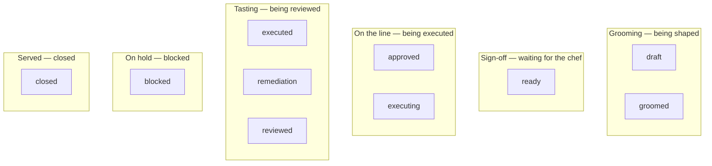
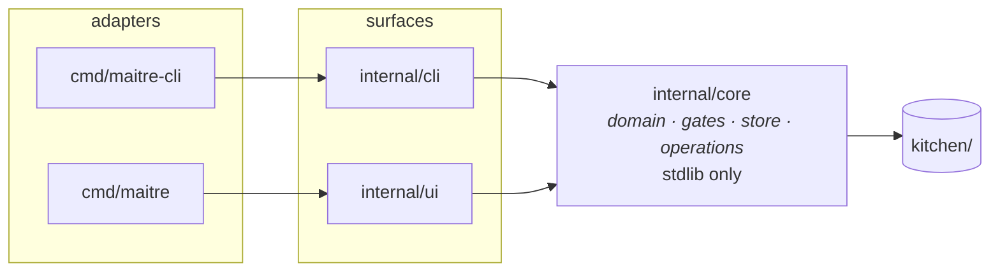

# 05 — The human console

> 🔄 Draft. `maitre` — what the chef does with it, and what it looks like.
> Premise 3: **the human interface is the main part.**

## The four jobs

From [ADR-0003](decisions/0003-surface-split.md), the console owns:

| Job | What it is |
|---|---|
| **View** | Read the plan well — the recipe as prose, the acceptance criteria with their proofs, the audit trail, findings anchored to code |
| **Decide** | Sign off, triage tasting notes, accept or reject a scope, choose what is next |
| **Manage the backlog** | Create, edit, promote, dismiss specials and prep notes |
| **Run** | Start, pause, watch, steer execution |

It does **not** author the recipe. An agent does that, in a conversation with the chef,
through `maitre-cli`.

## Tabs

| Tab | Holds | Job |
|---|---|---|
| **Recipes** | every recipe, triage-ordered | view · decide |
| **Backlog** | specials and prep notes | manage the backlog |
| **Path** | the execution order, and what blocks what | run |
| **Chopboard** | the same plan as a dependency tree — what waits on what | run |
| **Log** | the activity journal | see the audit trail |
| **Expo** | the automation's vital signs — and, one day, the automation | run |
| **Settings** | theme, keybinds, preferences | — |

v1's `raul` had **seven** lanes — Overview · Milestones · Path · Backlog · Ideas ·
Autopilot · Settings. Four are gone:

| v1 lane | Why it is gone |
|---|---|
| Overview | the triage-ordered board *is* the overview; a second tab would restate it |
| Milestones | → **Recipes**, our vocabulary |
| Ideas | folded into **Backlog** — a special is our idea |
| Autopilot | v2 has no orchestration; the running recipes are a section of the board |

## Lanes — the board's organising axis

Lanes are **derived**, never stored ([`docs/03-domain-model.md` § 8](03-domain-model.md#8-derived-views--computed-never-stored-c1)),
so the board can be reorganised without a data migration.



`On hold` is an **overlay**, not a state — a blocked recipe keeps its lifecycle state
and shows up in `On hold` instead of its own lane. That is why the lane is derived.

---

## Layout candidates

Four radically different answers to *"what is the board for?"*. Each renders the same
seven recipes, so they are directly comparable. The files are in
[`prototypes/`](../prototypes/README.md) — `cat` them.

### A — Triage queue · *what needs the chef*

`prototypes/board-triage.txt`

### B — Inventory · *what exists*

`prototypes/board-inventory.txt`

### C — Kanban · *where everything is*

`prototypes/board-kanban.txt`

### D — Focus · *what the chef is looking at*

`prototypes/board-focus.txt`

---

## Comparing them

| | Answers | Scales to hundreds | Shows the chef's next action | Shows flow between lanes |
|---|---|---|---|---|
| **A Triage** | *what needs me* | ✓ | **✓✓** | — |
| **B Inventory** | *what exists* | **✓✓** | ~ | — |
| **C Kanban** | *where is everything* | ✗ | ~ | **✓** |
| **D Focus** | *what am I looking at* | ✓ | **✓✓** | — |

C is the weakest on scale and the strongest on flow — but flow is the lane graph's job,
and the lane graph already exists as a derived view. It does not need a board.

## Decision

**A's ordering inside D's frame.** One screen, two panes:

- **Left** — a prioritised queue, ordered by what needs the chef.
- **Right** — the detail of the selected recipe.

C is dropped: the lane graph already shows flow, and it does not scale.
B is the *fallback* list — reachable with a key, for when the chef wants to browse
everything rather than be told what to look at.

The reason for the hybrid: the frame (list + detail) is not really in dispute — every
serious plan tool has one. The open question is **how the list is ordered**, and that is
a different question with a different answer per workflow.

### Ordering

**Triage first.** The list is ordered by what needs the chef:

```
needs you  →  awaiting your sign-off
           →  open tasting notes
           →  the only review is the executor's own
           →  reviewed and waiting to be served
on the line →  executing, approved and idle
being shaped→  draft, groomed
served     →  closed
```

The triage and the gates read the same derived fact. A self-reviewed recipe cannot
close — the gate refuses it — so the console has to say so, or the chef is never told
what is waiting.

**A section that says *you* must offer something.** The invariant is in
[docs/03-domain-model.md](03-domain-model.md#82-the-invariant-that-catches-the-class):
a recipe is filed under *Needs you* if and only if the console has a move for it. An
approved and idle recipe is *On the line* — the agents have it, and the console has
nothing that would unstick it.

**Switchable.** `1` triage · `2` lane-grouped · `3` plain by id. The list is a
projection, so re-ordering is a display concern.

**A checkbox for served.** `[x] show served` in the header, toggled with `c`. Served
recipes are noise most of the time; the checkbox makes hiding them one keypress instead
of a filter. Decorative — the keybind is the control.

### Names, not ids

wayfinder: *"Refer by name. A wall of `#42, #43, #44` is illegible; names read at a
glance."*

Our board currently leads with ids because v1 did. For a human surface, the title should
lead and the id should be secondary and dim — the id is for the agent and for searching.
This is a small change with a real effect on how the board reads. **Decided, not
applied:** the board still leads with the id.

### The Chopboard — the plan as a tree

The Path tab is the flat order; the **Chopboard** is the same plan as a tree. It is the
view v1's `raul` had: an execution trunk with labelled side branches, and blocked
milestones forked at their dependency.

```
● RCP01   draft       Sharpen the AC gate                           0/2
● RCP02   ready       Sign off the menu                             1/2
 └─ needs RCP02
   └─ RCP04   approved    Add the backlog view                          1/1 ● needs RCP02
● RCP05   executing   Sharpen the proof contract                    1/2
 └─ needs RCP05
   └─ RCP07   draft       Record the review protocol                    0/1 needs RCP05
```

- **The trunk** is the Path tab's ready list, in the same order. Two tabs showing one
  plan must not tell two stories, so the tree reads `core.Path`'s answer rather than
  computing a second one.
- **The branches** are the recipes that fork at a recipe — the ones waiting on it. A
  recipe with several unmet dependencies forks at the **first** one, the same rule
  `core.Path` uses, and its row says it needs them all: `needs RCP01, RCP02`.
- **A dangling dependency** is a broken plan, and the tree is where the chef sees it:
  the recipe is marked, and it names the dependency that is not in the plan.
- **A dependency cycle** is a broken plan too, and the tree draws it rather than
  dropping it: the recipes in the cycle, and the recipes that wait on them, are marked
  and said to be unexecutable. A recipe *in* the cycle and a recipe that merely
  *waits on* one are told apart — the first cannot be executed at all, the second can
  be, once the cycle is broken.
- The rows carry what the console already says about a recipe — the lifecycle, the
  proof count, the open tasting notes — and what it waits on.

Nothing is stored: the tree is a derived view (`core.TreeOf`), like every other thing
the console draws.

---

## The screen

The console **owns the terminal**: the alt screen, its own background, and the window
title. Quitting restores the terminal exactly, and the shell's scrollback stays clean.

```
row 0        maitre - <project>
row 1        --------------------------------------------
row 2        > Recipes   Backlog   Path   Chopboard   Log   Expo   Settings
row 3        7 recipes - 3 need you        refused - ac.covered
row 4..      the list - scrollable, fills to the bottom
row N-1      up/down move - tab switch - space sign off - q quit
```

- The **list scrolls** to keep the selection visible. Section headers scroll with their
  items, so a header can disappear while its items stay selected.
- The **footer is pinned** to the last row and is **contextual**: `space` means different
  things for a ready recipe (sign off), a self-reviewed one (review), a recipe with an
  open tasting note (triage), a reviewed one (serve), a special (promote). It never
  offers a move the gates would refuse.
- A **resize** re-lays out.
- At **160 columns and above** the detail pane appears beside the list; below that the
  list takes the whole terminal and `enter` opens the detail full screen. A split at 100
  columns leaves neither side readable.

## Interaction

| Key | Action |
|---|---|
| `↑` `↓` / `j` `k` | move in the list — scroll the detail when it is open |
| `tab` | next recipe |
| `enter` | expand the detail to full screen; on **Settings**, apply the theme under the cursor |
| `esc` | back to the split view |
| `n` `N` | move the cursor over the recipe's open tasting notes |
| `space` | the primary action for this recipe — sign off, review, triage, serve |
| `1` `2` `3` | list ordering: triage · lane · plain |
| `c` | show or hide served recipes |
| `r` | reload |
| `q` | quit |

**The theme is the chef's to pick.** The Settings tab lists the palettes under a
**THEME** heading; the cursor moves over them and `enter` applies the one under it. The
active theme is marked, so the chef can see which one is in force. The choice is for the
session: nothing is written to the plan, so a theme is a setting of the console, not of
the work.

| Theme | Ground |
|---|---|
| **Kitchen** | the console's own 256-colour palette — the default |
| Catppuccin Latte | light |
| Catppuccin Frappé · Macchiato · Mocha | dark |
| Dracula | dark |
| Alucard | light |

**The primary action is context-dependent, and it is always the chef's move.** It is
derived (`core.ChefMoveOf`), so the footer cannot offer a move the gates would refuse.

| Recipe | Move | What it does |
|---|---|---|
| `ready` | **sign off** | approve it |
| review stage, last round by the executor | **review** | ask for a verdict, then a reason |
| review stage, with an open tasting note | **triage** | dismiss the note, or say something in its thread |
| `reviewed`, independently reviewed | **serve** | close it |
| on hold, or cancelled | — | nothing. The console must not act on something the chef put aside |
| anything else | — | *nothing for you here — the agents have it* |

Claiming the work is an agent's move, and the console must not record itself as one.

**An open tasting note comes before the verdict.** A recipe can be both self-reviewed
and carry an open note; the note wins, because it is the concrete blocker — the close
gate refuses a recipe with an open note — and a verdict can wait. Triage the note, and
the review is offered next.

### The review prompt

The console never decides a verdict — it asks. `space` on a recipe whose only review
round was recorded by the agent that did the work opens the prompt in the footer:

```
 ▸ review RCP01 · o) ok · c) changes needed · esc cancel
 ▸ notes for RCP01 · ⏎ record · esc cancel · what I think
```

The round goes into the artifact with the chef's name on it, exactly like the journal.
A verdict the console invented would be a verdict nobody gave — the same lesson as the
console claiming work as `line-cook`.

`esc` cancels, and while the prompt is open every key belongs to it: the console must
not move the selection out from under a half-typed review.

### The triage prompt

One prompt, two questions. `space` on a recipe with an open tasting note asks what to
do with the note under the cursor:

```
 ▸ triage RCP03 F-01 · d) dismiss · c) comment · esc cancel
 ▸ notes for RCP03 F-01 · ⏎ record · esc cancel · the queue drops it on refresh
```

**The console offers the chef's moves only.** *Dismiss* closes the note without fixing
it, and carries the reason the chef typed. *Comment* adds the chef's words to the
note's thread. *Resolve* is not offered: marking a note fixed is the fixer's move —
the agent that did the work — and the console must not do an agent's job
([ADR-0003](decisions/0003-surface-split.md) §4). A chef who fixed something resolves
it through the CLI, like any other worker.

The cursor moves over the notes with `n` and `N`, and the note under it wears the
console's own selected-row style — the same style the recipe rows wear, so "selected"
means one thing on this screen. The footer names the key, because a key that is not
named is a key the chef cannot find.

A dismissal and a comment are the chef's: they carry the chef's name, and the journal
records them under the `chef` actor, so an agent polling for changes sees them.

### A script driving the console

The console is the chef's surface: a human pressing space in it is the chef deciding.
A script pressing space for them is the chef's decision *mediated by a machine* — and
the journal says which, so a reader can tell a human's verdict from a driven one:

```
31  comment  RCP01  chef  console-script
```

`maitre --keys` writes under the `console-script` session. The interactive console
writes under `console`. Nothing else changes: the actor is still the chef, because
the console is the chef's surface either way.

## The Expo

**A placeholder, and it says so.** The Expo is the orchestrator agent: it calls the
tickets, routes them, and keeps the line moving. It is not built, and the tab says
that plainly — a tab that is *waiting* must not look like a tab that is failing, and a
tab that is failing is worse than no tab at all.

```
 EXPO
  The orchestrator agent. It calls the tickets, routes
  them, and keeps the line moving.

  Not built yet. This tab is where the chef
  will watch the automation work.

 VITAL SIGNS
  plan written under  2
  this build speaks  2
  they agree

 LAST EVENT
  created     ·     chef      00:27:27
```

**The vital signs are why the tab exists before the autopilot does.** The chef can
already see whether the automation is running on the same rules as the plan: the
version the plan was last written under, the version this build speaks, and whether
they agree — because a plan written by a different build of the tool is a plan the
version guard will refuse to write. And the last thing that happened, so the chef can
see the automation moving even before it can be watched.

Nothing else is here: the recipe counts, the triage and the tree are the Recipes and
Chopboard tabs' business. The Expo shows what only the Expo can show.

---

## Live updates

**Built.** The console live-updates: a change on disk shows up without the chef
pressing `r`. The chef keeps their place — the recipe, the scroll, the note cursor,
the theme, the order, the served checkbox and the tab all survive the reload.

**A cheap mtime scan, once a second.** The console stats the plan's files and reloads
the plan when one of them has changed. No new dependency — `core` stays stdlib-only
and the UI stays under its budget. Stat'ing twenty files is microseconds.

| What is watched | Why |
|---|---|
| `project.json`, `activity.json`, `decisions.json` | the plan's metadata and its journal |
| `recipes/*.json`, `prep-notes/*.json`, `specials/*.json`, `courses/*.json` | the artifacts themselves |
| the directories holding them | a directory's own time changes when a file is added or removed — but not when a file inside it is rewritten, so both are watched |

The scan opens none of the files: it stats them and compares the result with the last
look. The plan is read only when something has actually changed, so an idle console
costs one stat per file per second and nothing else. A file that disappears between
the listing and the stat is skipped, and one that appears after the listing is seen by
the next scan — the plan is being written to at the same time, and the console has to
cope with that.

`r` still reloads by hand, and the interactive console is the only one that polls:
`--render` and `--keys` are not interactive programs, and a poll loop in one of them
would keep it alive.

A real watcher (fsnotify) would be more precise, but the polling cost here is
negligible and the dependency is not worth it yet. If it ever is, it is a drop-in.

## Prose

**`glamour`, themed to our palette.** A recipe's intent, problem and audit trail are
prose, and prose deserves real markdown — headings, lists, code blocks, tables.
`glamour` v2 is already in the dependency budget.

The risk is nested ANSI resets breaking lipgloss backgrounds. Mitigation: render the
markdown to a string first; lipgloss measures it ANSI-aware. If it fights us, plain
wrapped text is the fallback.

## Running work

**Observe and steer.** v2 has no orchestration — that is v2.2+. So the console:

- **observes** — what is running, its progress, its proofs, its open notes
- **steers** — the chef writes a note or a request onto the recipe, and the agent picks
  it up on its next turn

The console does not spawn agents. "Run and execute" means *watching and directing*, not
orchestrating.

## Refusals

A refused action is **information, not an error** — the gate working as designed.

Non-blocking, in place, naming the failed gates and what to fix — plus a durable record
in the activity journal: a `refusal` event naming the event, the gates and the reason.
The plan does not change — a refusal writes no artifact — but the attempt is real, and
the journal is the only event log.

## Architecture



`internal/core` has **zero external dependencies**. The console is replaceable — a
different TUI framework, a local web shell, a native app — without touching the domain.

---

## Open questions

1. **The backlog.** The three lower rungs share one list, or three? Deferred — slice 6,
   and it depends on [Q8](01-vision.md#q8--does-the-ladder-need-a-decision-shaped-rung).
2. **What does a request from the console look like?** "Steer by writing a note" is
   decided in principle; the shape — a note, an annotation, a task on the recipe — is
   not. It lands with the operation layer.
3. **How does the console know what the primary action is?** It is derived from the
   recipe's state, so it is another derived view. The set of actions per state is not
   written down yet.

### Decided

| | |
|---|---|
| Frame | list + detail, split, with a full-screen toggle |
| Ordering | triage first; `1` `2` `3` switch to lane and plain |
| Served recipes | shown by default, `c` toggles, shown as a checkbox in the header |
| Theme | the chef picks it in Settings; Kitchen is the default; the choice is for the session |
| Live updates | built: a cheap mtime scan, ~1 s, no new dependency — the console reloads the plan when a file on disk changes |
| Prose | `glamour`, themed to our palette |
| Running work | observe and steer; no agent spawning in v2 |
| Names | decided: the title should lead and the id should be secondary and dim — **not applied**; the board still leads with the id |
