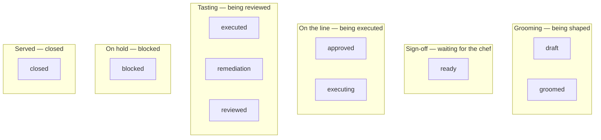
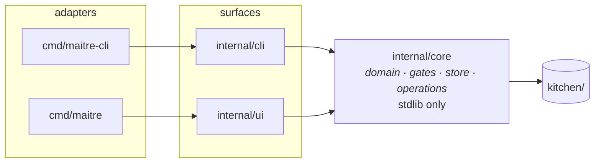

# 05 — The human console

> 🔄 Draft. `maitre` — what the chef does with it, and what it looks like.
> Premise 3: **the human interface is the main part.**

## The four jobs

From [ADR-0003](decisions/0003-surface-split.md), the console owns:

**This is the console's remit** — what the console is *for*, whether or not it is
built yet. What is **built** is the [keys](#interaction) below.

| Job | What it is |
|---|---|
| **View** | Read the plan well — the recipe as prose, the acceptance criteria with their evidence, the audit trail, findings anchored to code |
| **Decide** | Sign off, triage tasting notes, accept or reject a scope, choose what is next |
| **Manage the backlog** | Create, edit, shape, promote, dismiss backlog items |
| **Run** | Start, pause, watch, steer execution |

It does **not** author the recipe. An agent does that, in a conversation with the chef,
through `maitre-cli`.

## Tabs

| Tab | Holds | Job |
|---|---|---|
| **Home** | the plan's numbers — recipes, evidence, tasting, backlog, automation | see the plan at a glance |
| **Recipes** | every recipe, triage-ordered | view · decide |
| **Backlog** | backlog items — *Ideas* and *Small tasks*, derived from the kind | manage the backlog |
| **Ready** | what an agent could claim now, and the open small tasks | see · promote |
| **Board** | the same plan as a dependency tree — what waits on what | run |
| **Sous-Chef** | the automation — its order, its queue, and the crew's stamp *(T9 — planned)* | start · stop |
| **Log** | the activity journal | see the audit trail |
| **Settings** | theme, keybinds, preferences | — |

v1's `raul` had **seven** lanes — Overview · Milestones · Path · Backlog · Ideas ·
Autopilot · Settings. Four are gone:

| v1 lane | Why it is gone |
|---|---|
| Overview | the triage-ordered board *is* the overview; a second tab would restate it |
| Milestones | → **Recipes**, our vocabulary |
| Ideas | folded into **Backlog** — an idea is a backlog item of kind `idea` |
| Autopilot | v2 has no orchestration; the running recipes are a section of the board |

**Home is not the Overview.** The lane was dropped because it *restated the board* —
a second list of the same recipes. Home shows **numbers and never items**. The
board shows the recipes; Home shows their counts. The recipes' counts appear on
both, which is the chef's ruling — the full set. The evidence, the tasting, the
backlog and the automation's vital signs are counts beside those, and no row on
Home is selectable. A test holds it — see [the Home tab](#the-home-tab).

## Lanes — the board's organising axis

Lanes are **derived**, never stored ([`docs/03-domain-model.md` § 8](03-domain-model.md#8-derived-views--computed-never-stored-c1)),
so the board can be reorganised without a data migration.



`On hold` is an **overlay**, not a state — a blocked recipe keeps its lifecycle state
and shows up in `On hold` instead of its own lane. That is why the lane is derived.

### One word per fact

A recipe's **row** shows the plain state word — `closed`, `executing`. A **lane header**
is a section the board groups by — `Served`, `On the line` — and it is never a second
name for the row's state. The detail pane follows the same rule: the meta line holds
the state word and the facts beside it (how much is proven, what the tasting says),
and the lane's word appears nowhere beside it.

The reason is not tidiness. Two words for one fact is a place to drift: the two can
disagree, and the reader cannot tell which one the tool believes. A blocked recipe
says so on its own line, with the reason — that is a fact of its own, and the reason is
what the chef acts on.

---

## Layout candidates

Four radically different answers to *"what is the board for?"*. Each renders the same
seven recipes, so they are directly comparable. The files are in
[`prototypes/`](../prototypes/README.md) — `cat` them.

### A — Triage queue · *what needs the chef*

`prototypes/board-triage.txt`

### B — Inventory · *what exists*

`prototypes/board-inventory.txt`

### C — Kanban · *where everything is*

`prototypes/board-kanban.txt`

### D — Focus · *what the chef is looking at*

`prototypes/board-focus.txt`

---

## Comparing them

| | Answers | Scales to hundreds | Shows the chef's next action | Shows flow between lanes |
|---|---|---|---|---|
| **A Triage** | *what needs me* | ✓ | **✓✓** | — |
| **B Inventory** | *what exists* | **✓✓** | ~ | — |
| **C Kanban** | *where is everything* | ✗ | ~ | **✓** |
| **D Focus** | *what am I looking at* | ✓ | **✓✓** | — |

C is the weakest on scale and the strongest on flow — but flow is the lane graph's job,
and the lane graph already exists as a derived view. It does not need a board.

## Decision

**A's ordering inside D's frame.** One screen, two panes:

- **Left** — a prioritised queue, ordered by what needs the chef.
- **Right** — the detail of the selected recipe.

C is dropped: the lane graph already shows flow, and it does not scale.
B is the *fallback* list — reachable with a key, for when the chef wants to browse
everything rather than be told what to look at.

The reason for the hybrid: the frame (list + detail) is not really in dispute — every
serious plan tool has one. The open question is **how the list is ordered**, and that is
a different question with a different answer per workflow.

### Ordering

**Triage first.** The list is ordered by what needs the chef:

```
needs you  →  awaiting your sign-off
           →  open tasting notes
           →  the only review is the executor's own
           →  reviewed and waiting to be served
on the line →  executing, approved and idle
being shaped→  draft, groomed
served     →  closed
```

The triage and the gates read the same derived fact. A self-reviewed recipe cannot
close — the gate refuses it — so the console has to say so, or the chef is never told
what is waiting.

**A section that says *you* must offer something.** The invariant is in
[docs/03-domain-model.md](03-domain-model.md#82-the-invariant-that-catches-the-class):
a recipe is filed under *Needs you* if and only if the console has a move for it. An
approved and idle recipe is *On the line* — the agents have it, and the console has
nothing that would unstick it.

**Switchable.** `1` triage · `2` lane-grouped · `3` plain by id. The list is a
projection, so re-ordering is a display concern.

**A checkbox for served.** `[x] show served` in the header, toggled with `c`. Served
recipes are noise most of the time; the checkbox makes hiding them one keypress instead
of a filter. Decorative — the keybind is the control.

### Names, not ids

wayfinder: *"Refer by name. A wall of `#42, #43, #44` is illegible; names read at a
glance."*

Our board currently leads with ids because v1 did. For a human surface, the title should
lead and the id should be secondary and dim — the id is for the agent and for searching.
This is a small change with a real effect on how the board reads. **Decided, not
applied:** the board still leads with the id.

### The Board — the plan as a tree

**Ready** answers what an agent could claim now. The **Board** is the plan as a tree:
what waits on what. It is the view v1's `raul` had: an execution trunk with labelled
side branches, and blocked milestones forked at their dependency.

```
● RCP01   draft       Sharpen the AC gate                           0/2
● RCP02   ready       Sign off the menu                             1/2
 └─ needs RCP02
   └─ RCP04   approved    Add the backlog view                          1/1 needs RCP02
● RCP05   executing   Sharpen the evidence contract                1/2
 └─ needs RCP05
   └─ RCP07   draft       Record the review protocol                    0/1 needs RCP05
```

- **The trunk** is `core.Path`'s ready list, in the same order. The Ready tab answers
  a different question — what an agent could claim now — so the tree keeps reading
  `core.Path` rather than computing a second order.
- **The branches** are the recipes that fork at a recipe — the ones waiting on it. A
  recipe with several unmet dependencies forks at the **first** one, the same rule
  `core.Path` uses, and its row says it needs them all: `needs RCP01, RCP02`.
- **A dangling dependency** is a broken plan, and the tree is where the chef sees it:
  the recipe is marked, and it names the dependency that is not in the plan.
- **A dependency cycle** is a broken plan too, and the tree draws it rather than
  dropping it: the recipes in the cycle, and the recipes that wait on them, are marked
  and said to be unexecutable. A recipe *in* the cycle and a recipe that merely
  *waits on* one are told apart — the first cannot be executed at all, the second can
  be, once the cycle is broken.
- The rows carry what the console already says about a recipe — the lifecycle, the
  evidence count, the open tasting notes — and what it waits on.

Nothing is stored: the tree is a derived view (`core.TreeOf`), like every other thing
the console draws.

**Two drawings.** The width is the console's width. The membership does not change.

| Width | The board |
|---|---|
| **< 160** | the vertical tree above. The connectors are `├─` and `└─` |
| **≥ 160** | left to right. The trunk is the left column. A fork sits to the right of the recipe it waits on. A node shows the recipe's **title**, and what it waits on stays on the node |

A node that does not fit is truncated, so the row stays one line and the footer stays the last row. An orphan and a recipe a cycle cannot reach are drawn in both.

The wide board takes the width. A pane beside it would take the columns the forks need, so the detail opens on `enter` and on a click, in both drawings. The click's hit map is emitted by the render as it places the nodes.

---

## The screen

The console **owns the terminal**: the alt screen, its own background, and the window
title. Quitting restores the terminal exactly, and the shell's scrollback stays clean.

```
row 0        maitre - <project>
row 1        --------------------------------------------
row 2        > Home   Recipes   Backlog   Ready   Board   Log   Settings
row 3        7 recipes - 3 need you        refused - ac.covered
row 4..      the list - scrollable, fills to the bottom
row N-1      up/down move - tab switch - space sign off - q quit
```

**The window title carries the project.** It is the row the operating system puts on
the terminal's tab, and it reads `maitre · <project>` — the plan's own name, or the
name `maitre --project <name>` gives it for the session. It is the answer to *which of
my four terminals is this?*, and it is **not** the screen's row 0: that row is the
console's header, drawn inside the terminal, and it carries the same name.

- The **list scrolls** to keep the selection visible. Section headers scroll with their
  items, so a header can disappear while its items stay selected.
- The **footer is pinned** to the last row and is **contextual**: `space` means different
  things for a ready recipe (sign off), a self-reviewed one (review), a recipe with an
  open tasting note (triage), a reviewed one (serve), an **idea** in the backlog
  (shape it), a **small task** in the backlog (promote). It never offers a move the
  gates would refuse. The backlog's answer comes from the domain: an idea's move is a
  **shaping** — the kind changes and a scope is added, and the id does not — a small
  task's is its **promotion**, and a settled item has neither, so the footer offers no
  `space` there, and the item's detail says why.
- A **resize** re-lays out.
- At **160 columns and above** the detail pane appears beside the list; below that the
  list takes the whole terminal and `enter` opens the detail full screen. A split at 100
  columns leaves neither side readable. The **Board** is the exception: at 160 and above
  it uses the width for the tree, and the detail opens on `enter` or a click.

## Interaction

| Key | Action |
|---|---|
| `↑` `↓` / `j` `k` | move in the list — scroll the detail when it is open |
| `tab` | next tab |
| `enter` | expand the detail to full screen; on **Settings**, apply the theme under the cursor |
| `esc` | back to the split view |
| `n` `N` | move the cursor over the recipe's open tasting notes |
| `space` | the primary action for this recipe — sign off, review, triage, serve; on the **Backlog**, the item's move: shape an idea, promote a small task |
| `d` | on the **Backlog**, dismiss the selected item — the reason is asked for, and the domain appends it to the item's body |
| `a` | on the **Backlog**, write a new item down — it starts as an **idea**, the kind a hunch starts as |
| `1` `2` `3` | list ordering: triage · lane · plain |
| `c` | show or hide served recipes |
| `/` | filter the list — on **Recipes**, **Backlog** and **Ready** |
| `r` | reload |
| `q` | quit |

**The mouse is on.** The console asks the terminal for cell-motion reporting, so the
wheel and the click reach it. The wheel drives the same scroll the keyboard drives,
and **a click is a move**: it makes the move the key makes, and adds no state of its
own.

| Gesture | Where | What |
|---|---|---|
| wheel | over the detail pane | scroll the detail |
| wheel | anywhere else, **while the list is on screen** | scroll the list, keeping the selection visible |
| click | on a tab label | switch to that tab — the keyboard's `tab` |
| click | on a list row | select it — the keyboard's `↑` `↓` |
| click | on the detail pane | open the detail — the keyboard's `enter` |

The list is the console's one scrollable thing, so a wheel over the header scrolls the
list rather than nothing. The **full-screen detail** has no list beside it: there the
wheel over the header does nothing at all, and the wheel over the detail scrolls it.

The wheel's step is **three lines**: one is too slow to be useful, and a page is too
fast to aim with.

**A click on a row shows that recipe, and the layout decides how.** In the **split
layout** the detail is on screen beside the list, so the click selects and the detail
follows the selection. In the **narrow layout** the detail is not on screen at all, so
a click that only selected would show the chef nothing: there the click also opens
the detail. A click on a **Board** node does that in both drawings: it selects the
recipe and opens its detail, the same detail `enter` opens. The **Backlog** has a
detail of its own — the item's, with its body, its scope, its tags and its dates — so
a click on a backlog row opens it, exactly as a click on a recipe row opens the recipe.
A click on a **theme** row selects it — `enter` applies the theme.

**The mouse is drivable from a script.** `maitre --keys` takes the same steps the
console takes:

```
maitre --keys "wheel:down"         # the wheel, over the list
maitre --keys "wheel:down@(12,5)"   # the wheel, at column 12, row 5
maitre --keys "click@(12,2)"        # the click, at column 12, row 2
```

The coordinates are the terminal's own — zero-based, with (0, 0) at the upper-left
corner. The position is **bracketed**, because the steps are separated by commas and
the comma inside a position must not be one.

**The theme is the chef's to pick.** The Settings tab lists the palettes under a
**THEME** heading; the cursor moves over them and `enter` applies the one under it. The
active theme is marked, so the chef can see which one is in force. The choice is for the
session: nothing is written to the plan, so a theme is a setting of the console, not of
the work.

| Theme | Ground |
|---|---|
| **Kitchen** | the console's own 256-colour palette — the default |
| Catppuccin Latte | light |
| Catppuccin Frappé · Macchiato · Mocha | dark |
| Dracula | dark |
| Alucard | light |

**The primary action is context-dependent, and it is always the chef's move.** It is
derived (`core.ChefMoveOf`), so the footer cannot offer a move the gates would refuse.

| Recipe | Move | What it does |
|---|---|---|
| `ready` | **sign off** | approve it |
| review stage, last round by the executor | **review** | ask for a verdict, then a reason |
| review stage, with an open tasting note | **triage** | dismiss the note, or say something in its thread |
| `reviewed`, independently reviewed | **serve** | close it |
| on hold, or cancelled | — | nothing. The console must not act on something the chef put aside |
| anything else | — | *nothing for you here — the agents have it* |

Claiming the work is an agent's move, and the console must not record itself as one.

**An open tasting note comes before the verdict.** A recipe can be both self-reviewed
and carry an open note; the note wins, because it is the concrete blocker — the close
gate refuses a recipe with an open note — and a verdict can wait. Triage the note, and
the review is offered next.

### The review prompt

The console never decides a verdict — it asks. `space` on a recipe whose only review
round was recorded by the agent that did the work opens the prompt in the footer:

```
 ▸ review RCP01 · o) ok · c) changes needed · esc cancel
 ▸ notes for RCP01 · ⏎ record · esc cancel · what I think
```

The round goes into the artifact with the chef's name on it, exactly like the journal.
A verdict the console invented would be a verdict nobody gave — the same lesson as the
console claiming work as `runner`.

`esc` cancels, and while the prompt is open every key belongs to it: the console must
not move the selection out from under a half-typed review.

### The triage prompt

One prompt, two questions. `space` on a recipe with an open tasting note asks what to
do with the note under the cursor:

```
 ▸ triage RCP03 F-01 · d) dismiss · c) comment · esc cancel
 ▸ notes for RCP03 F-01 · ⏎ record · esc cancel · the queue drops it on refresh
```

**The console offers the chef's moves only.** *Dismiss* closes the note without fixing
it, and carries the reason the chef typed. *Comment* adds the chef's words to the
note's thread. *Resolve* is not offered: marking a note fixed is the fixer's move —
the agent that did the work — and the console must not do an agent's job
([ADR-0003](decisions/0003-surface-split.md) §4). A chef who fixed something resolves
it through the CLI, like any other worker.

The cursor moves over the notes with `n` and `N`, and the note under it wears the
console's own selected-row style — the same style the recipe rows wear, so "selected"
means one thing on this screen. The footer names the key, because a key that is not
named is a key the chef cannot find.

A dismissal and a comment are the chef's: they carry the chef's name, and the journal
records them under the `chef` actor, so an agent polling for changes sees them.

### A script driving the console

The console is the chef's surface: a human pressing space in it is the chef deciding.
A script pressing space for them is the chef's decision *mediated by a machine* — and
the journal says which, so a reader can tell a human's verdict from a driven one:

```
31  comment  RCP01  chef  console-script
```

`maitre --keys` writes under the `console-script` session. The interactive console
writes under `console`. Nothing else changes: the actor is still the chef, because
the console is the chef's surface either way.

## The filter

`/` filters the list of the tab the chef is on. It is the **console's** feature, not
the plan's: nothing is written to the plan, and the plan's format does not move —
`core.DomainVersion` stays **7**.

| | |
|---|---|
| **Opens on** | **Recipes**, **Backlog** and **Ready** — the tabs that list plan items |
| **The line** | one line under the summary, while the chef is typing in it |
| **Live** | the list filters as the chef types. No second keypress to apply it |
| **`enter`** | keeps the filter and closes the line |
| **`esc`** | clears the filter and closes the line. The list is whole again |
| **The match** | case-insensitive, over a **recipe's** id · title · intent (outcome and problem) · scope (in and out), and over a **backlog item's** id · title · body · scope · tags |
| **The count** | the summary says the filter is on and on what: `filter: <text> · N of M` — N matches of M items |
| **The selection** | stays on the same item when it still matches, goes to the first match when it does not, and the list scrolls to it |
| **The tabs** | the filter **survives a tab switch** and applies to the new tab's list |

**One rule, in one place.** The match is a single function, and every tab reads it: a
recipe and a backlog item are matched by the same case-insensitive substring rule.
Two implementations of "does this match" is this house's standing failure, and the
count in the summary comes from the same computation as the list it counts — the
count is the number of rows the list draws.

**A filter is a view of the plan; it does not change what the plan says about a
recipe.** The readiness mark is derived from the **whole** plan, so the filter
drops rows and not the plan the rows are read from: a recipe that waits on a
closed dependency keeps its `●` when the filter hides that dependency, and the
Ready tab still agrees about it.

A recipe carries **no tags** today — the tags are a domain decision, taken with the
CLI — and the filter does not invent one. The backlog's items carry tags, and the
filter reaches them.

**The section headers count what is shown.** A triage section with two matching
recipes says `2`, not the whole section's count. A section with no match is not
drawn at all — an empty section header is noise that says the plan has something it
does not have.

**The filter line takes exactly one row.** The list loses one row while the line is
open, and the footer stays the last row of the screen. A line that pushed the footer
off broke the screen.

### The tabs the filter does not reach

**Board**, **Log**, **Home** and **Settings**. `/` there says *the filter does not
apply here*, and nothing else changes.

The Board is a tree: a node is a relationship, and hiding one misstates what waits
on what. The Log holds journal events, not plan items. Home holds numbers and
Settings holds the plan's identity. **A key that does nothing must say so** — the
console does not promise a filter it will not honour.

**The message says so at every width.** It goes on the summary row's right, beside
the tab's own summary; where it does not fit — the Board's summary is wide — it
takes a row of its own, the way a refusal does. The list gives up that row, the
frame keeps its height, and the footer stays the last row.

### The filter from a script

The filter is drivable, like every other key:

```
maitre --keys "/,text:glossary,enter"    # the line, the word, and keep the filter
maitre --keys "/,g,l,o,s,s,a,r,y,enter"  # the same, one character at a time
```

`text:<string>` types a whole word in one step, in the colon style the mouse steps
use. The single-character steps keep working.

## The Home tab

**The landing tab: the plan's numbers, and nothing to press.** The console opens on
Home. It is the tab that answers *"where does this plan stand?"* before the chef
touches anything.

```
 THE PLAN
  name kb · path ~/Code/kitchen

 THE RECIPES
  total 7 · need you 2 · on the line 2 · being shaped 2 · on hold 0 · served 1

 THE EVIDENCE
  criteria 12 · proven 6 · failed 2 · rejected 0 · unproven 0 · pending 4

 THE TASTING
  open notes 1 · open findings 1

 THE BACKLOG
  ideas 4 · small tasks 2

 THE AUTOMATION
  the automation is not built
  plan written under 7 · this build speaks 7 · they agree
  last event created     ·     chef      00:27:27
```

### The invariant — numbers, never items

> **The Home tab shows numbers; it shows no items.**
>
> No row on Home is selectable, `space` does nothing there, and the tab's item count
> is zero. **A test holds it.**

v1's **Overview** lane was dropped because it *restated the board* — a second list
of the same recipes. The difference is numbers against items: the board shows the
recipes, and Home shows their counts. The recipes' counts appear on both — the
chef's ruling, the full set. The evidence, the tasting, the backlog and the
automation's vital signs are counts beside those, and Home shows them as numbers.
A second board would be a second story about the same plan.

The footer on Home promises no move: there is no item under the cursor, so there is
nothing to sign off, triage or serve.

### Where the numbers come from

Every number is the **domain's** — `core.PlanStats`, a derived view
([`docs/03` § 8](03-domain-model.md#8-derived-views--computed-never-stored-c1)).
A number the console counted itself is a number the CLI would count differently.

| Block | The numbers | Where they come from |
|---|---|---|
| The plan | the name · the path | `core.Project` and the plan's root |
| The recipes | total · need you · on the line · being shaped · on hold · served | the triage's sections — a partition, so the parts add up to the total |
| The evidence | criteria · proven · failed · rejected · unproven · pending | `core.EvidenceSummaryOf`, summed — every state, so the parts add up to the criteria |
| The tasting | open notes · open findings | `core.OpenFindingsOf` — the notes of any phase, and the ones the external tasting filed |
| The backlog | ideas · small tasks | `core.BacklogGroups` |
| The automation | the plan's version · this build's · the last event | the journal, and `core.DomainVersion` |

### The mark

The mark moved here from the Sous-Chef tab, and it sits **beside** the numbers —
the point of moving it is that it can share the space.

> **The decoration yields to the content, in both dimensions.** The mark is drawn
> only when it fits, in width *and* in height.

The numbers keep their column and the mark is drawn in what is left; the numbers
must be whole on the screen, and a tab whose numbers are cut off has no room for a
face. At **80×24** — the classic default — the numbers fill the width and the tab
is what it would be without the mark.

### The automation's vital signs

The Sous-Chef tab dissolved into Home, and its content is the **automation** block.
**The automation is not built**, and the block says so — the vital signs alone
would read as a running automation. What the block carries besides that is the
version the plan was last written under, the version this build speaks, and
whether they agree — because a plan written by a different build of the tool is a
plan the version guard will refuse to write — and the last thing that happened.

The orchestrator comes back as a tab when the orchestrator does.

---

## Live updates

**Built.** The console live-updates: a change on disk shows up without the chef
pressing `r`. The chef keeps their place — the recipe, the scroll, the note cursor,
the theme, the order, the served checkbox and the tab all survive the reload.

**A cheap mtime scan, once a second.** The console stats the plan's files and reloads
the plan when one of them has changed. No new dependency — `core` stays stdlib-only
and the UI stays under its budget. Stat'ing twenty files is microseconds.

| What is watched | Why |
|---|---|
| `project.json`, `activity.json`, `decisions.json` | the plan's metadata and its journal |
| `recipes/*.json`, `backlog/*.json`, `courses/*.json` | the artifacts themselves |
| the directories holding them | a directory's own time changes when a file is added or removed — but not when a file inside it is rewritten, so both are watched |

The scan opens none of the files: it stats them and compares the result with the last
look. The plan is read only when something has actually changed, so an idle console
costs one stat per file per second and nothing else. A file that disappears between
the listing and the stat is skipped, and one that appears after the listing is seen by
the next scan — the plan is being written to at the same time, and the console has to
cope with that.

`r` still reloads by hand, and the interactive console is the only one that polls:
`--render` and `--keys` are not interactive programs, and a poll loop in one of them
would keep it alive.

A real watcher (fsnotify) would be more precise, but the polling cost here is
negligible and the dependency is not worth it yet. If it ever is, it is a drop-in.

## Prose

**`glamour`, themed to our palette.** A recipe's intent, problem and audit trail are
prose, and prose deserves real markdown — headings, lists, code blocks, tables.
`glamour` v2 is already in the dependency budget.

The risk is nested ANSI resets breaking lipgloss backgrounds. Mitigation: render the
markdown to a string first; lipgloss measures it ANSI-aware. If it fights us, plain
wrapped text is the fallback.

## Running work

**Observe and steer.** v2 has no orchestration — that is v2.2+. So the console:

- **observes** — what is running, its progress, its evidence, its open notes
- **steers** — the chef writes a note or a request onto the recipe, and the agent picks
  it up on its next turn

The console does not spawn agents. "Run and execute" means *watching and directing*, not
orchestrating.

## Refusals

A refused action is **information, not an error** — the gate working as designed.

Non-blocking, in place, naming the failed gates and what to fix — plus a durable record
in the activity journal: a `refusal` event naming the event, the gates and the reason.
The plan does not change — a refusal writes no artifact — but the attempt is real, and
the journal is the only event log.

## Architecture



`internal/core` has **zero external dependencies**. The console is replaceable — a
different TUI framework, a local web shell, a native app — without touching the domain.

---

## Open questions

1. **The backlog.** The three lower rungs share one list, or three? Deferred — slice 6,
   and it depends on [Q8](01-vision.md#q8--does-the-ladder-need-a-decision-shaped-rung).
2. **What does a request from the console look like?** "Steer by writing a note" is
   decided in principle; the shape — a note, an annotation, a task on the recipe — is
   not. It lands with the operation layer.
3. **How does the console know what the primary action is?** It is derived from the
   recipe's state, so it is another derived view. The set of actions per state is not
   written down yet.
4. **Where do the console's settings live?** **Ruled: in the plan's folder, in a
   new file** — `kitchen/settings.json`, owned by the **tool**. The settings are not
   a plan *record* and carry no rules, so the plan's format does not move and
   `DomainVersion` stays 7. The file carries its own `version`. See
   [work/tui/plan-automation.md § 15](../work/tui/plan-automation.md).

### Decided

| | |
|---|---|
| Frame | list + detail, split, with a full-screen toggle |
| Ordering | triage first; `1` `2` `3` switch to lane and plain |
| Served recipes | shown by default, `c` toggles, shown as a checkbox in the header |
| Theme | the chef picks it in Settings; Kitchen is the default. The choice was *for the session*; it is now persisted in the plan's `settings.json` |
| Settings | the view's preferences live in `kitchen/settings.json` — the tool's own file, in the plan's folder. It carries its own `version`; the plan's format does not move |
| Live updates | built: a cheap mtime scan, ~1 s, no new dependency — the console reloads the plan when a file on disk changes |
| Prose | `glamour`, themed to our palette |
| Running work | observe and steer; no agent spawning in v2 |
| Names | decided: the title should lead and the id should be secondary and dim — **not applied** on the vertical tree, which still leads with the id. At 160 columns and above the node shows the title |
