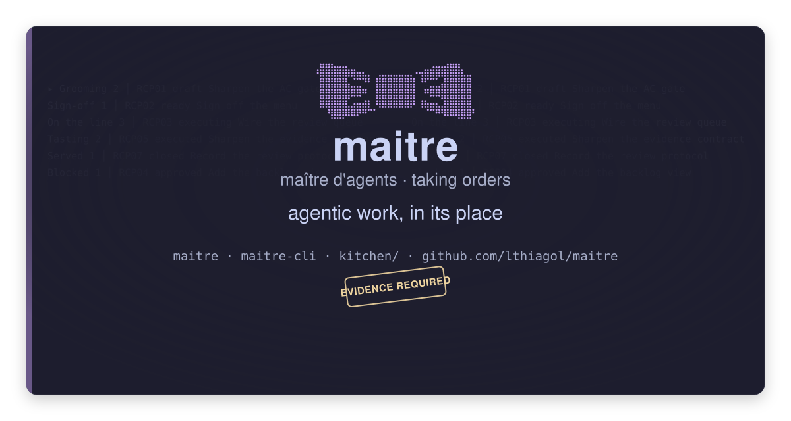

# The mark

**The banner is [`9-plan-behind.svg`](9-plan-behind.svg).** The PNG next to it is the
same thing for the places that will not render an SVG.

The plan behind it is the tool's own output, from the seeder's recipes: `RCP01 Sharpen
the AC gate`, `RCP02 Sign off the menu`, `RCP03 Wire the review queue`, `RCP04 Add the
backlog view`, `RCP05 Sharpen the evidence contract`, `RCP07 Record the review
protocol`.

## The fixed copy

| Slot | Copy |
|---|---|
| Wordmark | `maitre` |
| Title | `maître d'agents · taking orders` |
| Tagline | *agentic work, in its place* |
| Contact | `maitre` — the console · `maitre-cli` — the agent CLI · `github.com/lthiagol/maitre` · `kitchen/` — the plan |
| Stamp | `EVIDENCE REQUIRED` |
| Emblem | the bow tie, drawn as the dots the terminal draws |
| Background | the board, dim |

The README's first line is *put your work in its place*.

## The mark, in braille

The emblem is a **halftone** of a bow tie — two wings with folded-ribbon highlights
and a solid square knot. The terminal draws it with braille characters, which are
2 dots wide and 4 tall; the card draws the same dots as circles. One drawing, two
media.

- [`ascii/bow-tie-full.txt`](ascii/bow-tie-full.txt) — 28×5, the TUI's full form
- [`ascii/bow-tie-half.txt`](ascii/bow-tie-half.txt) — 14×5, the mid-size
- **compact** — `⋈`, one glyph, for the console's header

The art is 28 columns wide **at its widest** — the first row is 26 — so it fits the
console's budget, and it **survives being halved**: at 14 columns it is still
unmistakably a bow tie.

## Archived

[`archived/`](archived/) holds the fourteen other cards — the classic, the place card,
the letterhead, the night card, both sides, the braille variants, the docket on the
left, the docket band, the wallpaper, the card on the console, and the emblem alone.
They are the reasoning behind the banner, kept because the next banner will need it.

The tree in the card is **drawn**, not typed: the branches join the trunk. The TUI's own
tree stays text, because a terminal is text.
